# Multi-Object Tracking for Sports Analytics: Player and Ball Tracking

**Proposed system:** YOLO11n + ByteTrack (players) + Kalman filter (ball)
**Baselines:** YOLO11n + SORT, YOLO11n + OC-SORT
**Datasets:** SportsMOT, UVY-Track, InFactory Soccer Ball Tracking
**Course:** Computer Vision (B.Tech, Semester 7)

> All numbers in this report are produced by the code in this repository and are
> regenerated from `results/metrics/` by `scripts/make_report_tables.py`. They are
> computed on small subsets of each dataset with a generic COCO-pretrained detector
> on a laptop CPU. They are **not** official benchmark scores and are not comparable
> with leaderboard entries.

---

## 1. Abstract

This project implements and evaluates a lightweight system that tracks soccer
players and the ball in monocular video. A COCO-pretrained YOLO11n detector finds
people and the ball in one pass per frame; ByteTrack assigns persistent player
identities; a constant-velocity Kalman filter tracks the ball and predicts its
position through short detection gaps, always labelling predictions as such. The
system writes an annotated video, a per-frame CSV and a JSON summary, and is
covered by 109 automated tests.

The proposed player tracker is compared with SORT and OC-SORT on identical cached
detections from six test sequences of two datasets (SportsMOT and UVY-Track,
2,950 frames), with hyper-parameters chosen on a separate sequence. The ball
tracker is compared with detection-only output on 13 sequences of UVY-Track and
InFactory (3,019 frames, 2,402 with a visible ball).

Main findings. (i) On SportsMOT, ByteTrack gives the fewest identity switches (51,
against 60 for SORT and 106 for OC-SORT) and the highest recall (95.9%), but tuned
SORT reaches a higher HOTA (65.9 against 62.6) because it outputs fewer boxes on
people the benchmark does not annotate; with untuned shared defaults the three
trackers are within 0.8 HOTA of each other. (ii) On the partially labelled
UVY-Track clips, ByteTrack has the best OWTA (56.8), detection recall and ID-switch
count. (iii) The Kalman ball tracker raises ball recall from 34.5% to 43.3% and F1
from 45.4% to 49.3%, and makes the ball track far more continuous (168 correct
segments merge into 47), at the cost of precision (66.4% to 57.4%): only 43% of
its predicted positions are correct. (iv) The detector dominates both the error
budget and the runtime: 87% of the 330 ms per frame on a laptop CPU (about 3 FPS).
The proposed method is therefore not uniformly better than the baselines; the
report states where it helps, where it does not, and why.

## 2. Introduction

Broadcast and amateur sports video is now analysed automatically for coaching,
scouting, officiating support and fan engagement. Almost every such analysis
(distance covered, possession, heatmaps, pass maps, tactical shape) starts from the
same two signals: *where every player is over time, with a stable identity*, and
*where the ball is*. Producing these signals from a single camera is a
multi-object tracking (MOT) problem with sport-specific difficulties:

* players of one team look alike, so appearance gives little help in telling them apart;
* motion is fast and non-linear, with frequent occlusion in duels and set pieces;
* broadcast cameras pan and zoom, so image motion mixes camera and player motion;
* the ball is tiny (often 5-20 pixels), blurred, frequently hidden, and moves much
  faster than any player.

This project builds a complete, lightweight tracking-by-detection system for this
task and evaluates it quantitatively. It runs on a CPU, uses only pretrained
models, and is organised so that each stage (detector, player tracker, ball
tracker) can be replaced and measured independently.

## 3. Problem statement

Given a monocular sports video, produce for every frame:

1. a bounding box and a **persistent identity** for every player, and
2. the position of the ball, stating explicitly whether that position was
   **detected** in the frame or **predicted** by a motion model,

and quantify how well this is done: detection quality, identity preservation,
ball coverage and processing speed, compared against baseline trackers under
identical conditions.

## 4. Project objectives

1. Detect players and the ball in soccer video with a lightweight pretrained detector.
2. Track players with persistent IDs using ByteTrack.
3. Track the ball with a dedicated Kalman-filter tracker that bridges short
   detection gaps, never presenting a predicted position as a detection.
4. Export an annotated video, a per-frame tracking CSV and a JSON run summary.
5. Compare the proposed tracker with two baselines (SORT, OC-SORT) on identical
   detections, sequences, frames and ground truth.
6. Evaluate on three public datasets with standard metrics (HOTA, DetA, AssA,
   MOTA, IDF1, ID switches, FP, FN, fragmentation; precision, recall, F1, AP@0.5
   for the ball; FPS and per-frame latency).
7. Produce plots, a results database and reproducible scripts.

## 5. Literature review / related work

**Tracking by detection.** Modern MOT systems detect objects in every frame and
then associate detections over time. SORT [1] showed that a Kalman filter [14]
for motion prediction plus Hungarian assignment [15] on bounding-box IoU is a
strong and extremely fast baseline. DeepSORT [2] added an appearance embedding to
reduce identity switches through occlusion. ByteTrack [3] observed that discarding
low-confidence detections throws away true objects that are occluded or blurred,
and introduced a second association stage that matches the remaining tracks to
low-confidence boxes. OC-SORT [4] kept SORT's simplicity but corrected the Kalman
filter's error accumulation during occlusion with an observation-centric
re-update, and added a motion-direction consistency term and a recovery step.
BoT-SORT [5] combined ByteTrack with camera-motion compensation and re-identification.

**Tracking in sports.** Manafifard et al. [20] survey player tracking in soccer
video. SoccerNet-Tracking [10] and SportsMOT [9] are the main public benchmarks;
SportsMOT emphasises fast, variable-speed motion and similar appearance and
reports that association, not detection, is the bottleneck in sports. SoccerTrack
[18] and TeamTrack [19] provide full-pitch fisheye and drone footage. UVY-Track
[11, 12] targets unconstrained user-generated sports video rather than broadcast footage.

**Ball detection and tracking.** The ball is a small-object problem. DeepBall [16]
and TrackNet [17] use specialised fully convolutional networks; TrackNet stacks
consecutive frames so the network can exploit motion. Slicing-aided inference
(SAHI) [21] improves small-object recall for generic detectors by running them on
overlapping tiles. A common lightweight alternative, used here, is to keep a
generic detector and add a single-target motion model that rejects implausible
candidates and bridges short gaps.

**Detectors.** The YOLO family [6] performs detection in a single network pass.
This project uses the COCO-pretrained [8] YOLO11 nano model from Ultralytics [7].

**Evaluation.** CLEAR-MOT [23] defines MOTA, which is dominated by detection
errors. IDF1 [24] measures identity preservation. HOTA [22] balances detection
(DetA) and association (AssA) explicitly and is the primary metric of SportsMOT.

## 6. Research gap and motivation

* Published sports trackers are usually evaluated with detectors fine-tuned on
  the benchmark and on GPUs. Less is reported about how the classic trackers
  behave with a **generic, lightweight, CPU-friendly detector**, which is the
  realistic setting for a low-cost system.
* Players and the ball are different tracking problems. Players are many
  similar objects needing global assignment; the ball is one tiny, frequently
  missed object. Benchmarks such as SportsMOT annotate players only, so the ball
  is often left out of the evaluation altogether.
* When a system interpolates the ball position, results frequently do not say
  which positions were observed and which were inferred.

This motivates a **hybrid** design: a multi-object tracker for players and a
dedicated single-target Kalman tracker for the ball, evaluated separately, with
predicted ball positions labelled as such everywhere.

## 7. Proposed system architecture

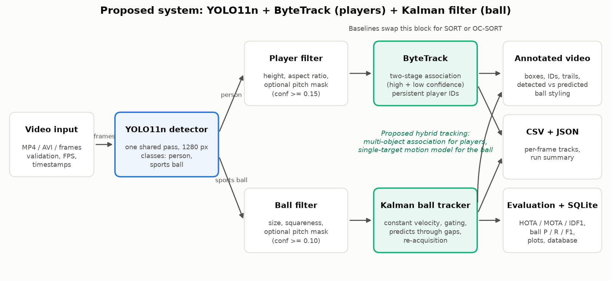

One YOLO11n pass per frame serves both players (`person`) and ball
(`sports ball`). Cheap geometric filters remove implausible boxes. Player boxes go
to ByteTrack; ball candidates go to the Kalman ball tracker. The tracked objects
are drawn on the frame and streamed to a CSV; a JSON summary is written at the end.
For the baselines only the player-tracker block is swapped for SORT or OC-SORT.

| Stage | Component | Implementation |
|---|---|---|
| Input | Video validation, decoding, timestamps | `video_io.py` (OpenCV) |
| Detection | YOLO11n, 1280 px, one shared pass for `person` + `sports ball` | `detection/yolo.py` (Ultralytics) |
| Filtering | Player height / aspect ratio; ball size / squareness; optional pitch mask | `detection/filters.py` |
| Player tracking | **ByteTrack** (proposed); SORT, OC-SORT (baselines) | `tracking/player_tracker.py`, `tracking/factory.py` (Roboflow `trackers`) |
| Ball tracking | **Constant-velocity Kalman filter** with gating, coasting, re-acquisition | `tracking/ball_tracker.py` |
| Output | Annotated MP4, tracks CSV, JSON summary | `visualization.py`, `analytics.py` |
| Evaluation | HOTA / CLEAR / Identity; ball and detection metrics; plots; SQLite | `evaluation/`, `experiments/` |

## 8. Dataset descriptions

Three datasets are used; details, formats and download commands are in
[DATASETS.md](../DATASETS.md).

| | SportsMOT [9] | UVY-Track [11, 12] | InFactory Soccer Ball Tracking [13] |
|---|---|---|---|
| Footage | Professional broadcast (football, basketball, volleyball) | User-generated YouTube sports videos, 7 sports | Professional soccer broadcast |
| Annotation format | MOT Challenge text | MOT-style text with class column | YOLO text, one file per frame |
| Annotated objects | Players on the pitch only | player, goalkeeper, referee, sports ball, goal, camera | Ball only (+ "ball not visible" frames) |
| Persistent IDs | Players | People and ball | None |
| Role in this project | Player tracking (tuning + test) | Player tracking + ball detection/tracking (test) | Ball detection (test) |
| Subset used | 4 football sequences of the validation split, 1,831 frames | 3 soccer sequences, 1,569 frames | 10 clips, 1,450 frames (884 visible ball, 566 not visible) |

Sequences evaluated:

<!-- TABLE:sequences -->
| Dataset | Sequence | Role | Frames | Source frames | Resolution | Player tracks (GT) | Player boxes (GT) | Visible-ball frames (GT) |
|---|---|---|---|---|---|---|---|---|
| SportsMOT | `v_2QhNRucNC7E_c017` | dev | 450 | 1-450 | 1280x720 | 21 | 6622 | n/a |
| SportsMOT | `v_dw7LOz17Omg_c067` | test | 450 | 1-450 | 1280x720 | 22 | 6959 | n/a |
| SportsMOT | `v_G-vNjfx1GGc_c008` | test | 480 | 1-480 | 1280x720 | 20 | 4573 | n/a |
| SportsMOT | `v_i2_L4qquVg0_c007` | test | 451 | 1-451 | 1280x720 | 21 | 4828 | n/a |
| UVY-Track | `soccer_V04` | test | 219 | 1-219 | 1280x720 | 19 | 3394 | 168 |
| UVY-Track | `soccer_V01` | test | 750 | 1-750 | 636x360 | 6 | 3067 | 750 |
| UVY-Track | `soccer_V03` | test | 600 | 82-681 | 1280x720 | 5 | 3000 | 600 |
| InFactory | `032ca2db` | test | 85 | 0-84 | 1280x720 | n/a | n/a | 85 |
| InFactory | `0f8fc039` | test | 243 | 0-242 | 720x608 | n/a | n/a | 26 |
| InFactory | `2e3b6c35` | test | 588 | 0-587 | 720x608 | n/a | n/a | 321 |
| InFactory | `3f96530a` | test | 84 | 0-83 | 720x608 | n/a | n/a | 84 |
| InFactory | `5c2081b3` | test | 105 | 0-104 | 1280x720 | n/a | n/a | 105 |
| InFactory | `71125020` | test | 35 | 0-34 | 1280x720 | n/a | n/a | 35 |
| InFactory | `7d503a7a` | test | 80 | 0-79 | 1280x720 | n/a | n/a | 80 |
| InFactory | `81926caa` | test | 40 | 0-39 | 1280x720 | n/a | n/a | 19 |
| InFactory | `b0558318` | test | 160 | 0-159 | 1280x720 | n/a | n/a | 128 |
| InFactory | `bd8d9aab` | test | 30 | 0-29 | 1280x720 | n/a | n/a | 1 |
<!-- /TABLE:sequences -->

Rules followed:

* one adapter per dataset; annotations from different datasets are never mixed;
* the annotation format of each dataset was inspected on the downloaded files
  before its loader was written (UVY-Track, for example, is not YOLO format);
* **one** SportsMOT sequence (`v_2QhNRucNC7E_c017`) is the "dev" sequence used to
  choose tracker hyper-parameters; it comes from a different source video than
  every test sequence and is never included in test averages;
* nothing is tuned on UVY-Track or InFactory;
* InFactory has no ball identities, so only detection-type metrics are reported for it.

## 9. Methodology

The system follows the tracking-by-detection paradigm.

1. **Detection.** YOLO11n (COCO weights, 2.6 M parameters) is run once per frame at
   1280 px. Detections of `person` with confidence >= 0.15 and of `sports ball`
   with confidence >= 0.10 are kept; the thresholds are deliberately low because
   the trackers, not the detector threshold, decide what to trust.
2. **Filtering.** Player boxes must be 12 px to 60% of the frame tall with a
   height/width ratio between 0.8 and 6. Ball boxes must be 2-80 px and roughly
   square (aspect ratio <= 2).
3. **Player tracking.** ByteTrack associates boxes with existing tracks and
   assigns IDs (Section 10).
4. **Ball tracking.** A single-target Kalman tracker selects at most one ball
   candidate per frame and predicts through gaps (Section 11).
5. **Output.** Boxes, IDs, trails, the ball marker and a status line are drawn;
   one CSV row is written per object per frame.

For the experiments the detector output is **cached per sequence**. Every tracker
then replays exactly the same detections, so differences between methods are due
to the tracking algorithm alone.

## 10. Player detection and tracking

All three trackers share the same structure: predict each track's box with a
Kalman filter, build an IoU cost matrix between predicted boxes and detections,
solve the assignment with the Hungarian algorithm, update matched tracks, start
new tracks from unmatched detections and delete tracks that stay unmatched for
`lost_track_buffer` frames. They differ in how detections are used:

| | SORT [1] | OC-SORT [4] | ByteTrack [3] (proposed) |
|---|---|---|---|
| Association stages | One | One, plus observation-centric recovery | Two |
| Use of confidence | Any detection may match a track; new tracks need `track_activation_threshold` | Only detections above `high_conf_det_threshold` are used | High-confidence boxes first; low-confidence boxes then rescue unmatched tracks |
| Extra motion modelling | None | Re-update after occlusion, direction consistency | None |
| Appearance features | None | None | None |

**Why ByteTrack is the proposed player tracker.** In sports, players are often
partly occluded or motion-blurred, which lowers detector confidence without the
player disappearing. ByteTrack is designed to keep such tracks alive using the
low-confidence boxes instead of dropping them, which should reduce identity
switches and fragmentation. It needs no appearance model, so it stays fast on a
CPU and is not confused by identical kits.

## 11. Ball detection and tracking

Ball candidates come from the COCO `sports ball` class of the same YOLO11n pass.
The ball tracker (`tracking/ball_tracker.py`) is a constant-velocity Kalman filter
with state `[x, y, vx, vy]`:

* **Gating.** A candidate is accepted only within a gate (80 px, growing by 20 px
  per missed frame) around the predicted position; among several, the one with the
  best `confidence x (1 - distance / gate)` is taken. This rejects false "balls"
  elsewhere in the image (socks, heads, line markings).
* **Confirmation.** A track is reported only after 2 detections, suppressing
  one-frame false positives.
* **Prediction through gaps.** With no accepted candidate, the filter coasts for up
  to 15 frames and the output is labelled `predicted`.
* **Re-acquisition.** A confident detection (>= 0.5) outside the gate restarts the
  track after 3 missed frames, which handles long passes and camera cuts.

Predicted positions are kept distinct end to end: orange marker and the text
"ball (predicted)" in the video, `status=predicted` with an empty confidence in the
CSV, separate counts in the JSON summary, and separate rows and columns in every
ball table of this report.

**Why a separate tracker for the ball.** There is at most one match ball, so
multi-object assignment is unnecessary; the difficulty is deciding *which*
candidate, if any, is the ball, and what to output when it is not detected. This
is what the motion model contributes. Together, ByteTrack for players and the
Kalman tracker for the ball form the proposed hybrid.

## 12. Baseline methods

| Name used everywhere | Detector | Player tracker | Ball |
|---|---|---|---|
| YOLO11n + SORT | YOLO11n | SORT | n/a (player-tracking baseline) |
| YOLO11n + OC-SORT | YOLO11n | OC-SORT | n/a (player-tracking baseline) |
| **YOLO11n + ByteTrack (proposed)** | YOLO11n | ByteTrack | Kalman-filter ball tracker |

All three implementations come from the Roboflow `trackers` package (v2.6.1) and
share one `update()` interface, so no tracker was re-implemented.

**Fairness protocol.**

* identical cached YOLO11n detections, sequences, frame ranges and ground truth;
* identical pre-filter and identical evaluator;
* hyper-parameters chosen per tracker on the dev sequence with the **same
  48-point grid** and the same rule (highest HOTA, ties broken by IDF1):
  `lost_track_buffer` in {30, 60}, `minimum_consecutive_frames` in {1, 3},
  `minimum_iou_threshold` in {0.1, 0.2, 0.3}, confidence threshold in
  {0.3, 0.4, 0.5, 0.6};
* results are reported for the dev-tuned parameters (main tables) **and** for one
  shared set of untuned project defaults, so the effect of tuning is visible.

<!-- TABLE:selected_params -->
| Parameter set | `lost_track_buffer` | `minimum_consecutive_frames` | `minimum_iou_threshold` | `track_activation_threshold` | `high_conf_det_threshold` |
|---|---|---|---|---|---|
| Project default (all trackers) | 30 | 3 | 0.10 | 0.50 | 0.50 |
| SORT, dev-tuned | 30 | 1 | 0.30 | 0.60 | not used |
| OC-SORT, dev-tuned | 60 | 1 | 0.30 | not used | 0.30 |
| ByteTrack (proposed), dev-tuned | 30 | 1 | 0.20 | 0.50 | 0.50 |
<!-- /TABLE:selected_params -->

For the ball, two outputs are compared on identical candidates:

* **Detection only:** the most confident ball candidate of each frame, no temporal reasoning;
* **Kalman tracker (proposed):** detected + predicted positions; the detected-only
  part of its output is also reported as an ablation.

## 13. Performance metrics

**Player tracking** (computed with `trackers.eval`, a re-implementation designed
to match TrackEval, the reference evaluator of MOTChallenge and SportsMOT; matching
at IoU >= 0.5 for CLEAR and Identity metrics):

| Metric | Meaning |
|---|---|
| HOTA [22] | Geometric mean of detection and association accuracy, averaged over IoU thresholds 0.05-0.95. Primary metric |
| DetA / AssA | Detection accuracy / association accuracy components of HOTA |
| OWTA [27], DetRe | Open-world tracking accuracy, sqrt(DetRe x AssA), and detection recall. They do not penalise false positives, so they remain valid when only part of the people are labelled (UVY-Track) |
| MOTA [23] | 1 - (FN + FP + IDSW) / GT boxes. Dominated by detection errors; can be negative |
| IDF1 [24] | F1 score of correctly identified detections under the best global ID mapping |
| IDSW | Number of identity switches |
| FP / FN | False-positive / missed boxes |
| Frag | Number of times a ground-truth track is interrupted |
| MT / ML | Ground-truth tracks covered for >= 80% / <= 20% of their length |

**Ball** (this project's own evaluator, `evaluation/ball.py` and
`evaluation/detection.py`; documented, unit-tested on hand-computed cases, **not**
an official benchmark evaluator):

| Metric | Meaning |
|---|---|
| Precision, recall, F1 | Per frame, at most one output. Recall is the *visible-ball recall*: correct outputs / frames with a visible ball |
| Matching criterion "dist" | Output centre within one ball diameter of the true centre. Used as the main criterion |
| Matching criterion "IoU" | IoU >= 0.5 with the ground-truth box. Standard but very strict for a 10-20 px object |
| AP@0.5 | Average precision of all ball candidates ranked by confidence (single class, so mAP@0.5 = AP@0.5) |
| Coverage | Frames with any ball output / labelled frames |
| Centre error | Mean pixel distance between output and true centre, over visible frames with an output |
| Continuity | Number of correctly tracked segments and breaks inside visible-ball runs; longest and mean segment |
| Ball ID switches | Only on UVY-Track, which has persistent ball identities. Never reported for InFactory |

**Runtime.** Median time per frame of each pipeline stage, tracking-stage latency
per tracker, and frames per second of the full pipeline.

## 14. Experimental setup

<!-- TABLE:system -->
| Item | Value |
|---|---|
| CPU | Intel(R) Core(TM) 7 150U |
| Cores (physical / logical) | 10 / 12 |
| RAM | 15.7 GB |
| GPU | none (CUDA not available) |
| Inference device | cpu |
| Power source during the benchmark | AC power |
| Operating system | Windows-10-10.0.26200-SP0 (Windows 11) |
| Python | 3.11.9 |
| PyTorch | 2.14.1+cpu (8 threads) |
| Ultralytics | 8.4.182 |
| Roboflow trackers | 2.6.1 |
| supervision | 0.31.0 |
| OpenCV | 5.0.0 |
| Benchmark sequence | SportsMOT/v_dw7LOz17Omg_c067, 150 frames, 1280x720 |
<!-- /TABLE:system -->

* Detector: `yolo11n.pt` (official Ultralytics COCO weights), input size 1280,
  NMS IoU 0.5, shared pass for both classes.
* Ball tracker: default configuration (`configs/default.yaml`), not tuned on any
  evaluated sequence.
* Frames evaluated: 4,850 in total (1,831 SportsMOT, 1,569 UVY-Track, 1,450 InFactory).
* Everything is reproduced by `python scripts/run_experiments.py all`; the
  sequences are fixed in `configs/experiments.yaml`.

## 15. Results and baseline comparison

### 15.1 Player detection (detector only)

Before any tracking, the detector output is compared with the ground-truth player
boxes (custom evaluator, confidence >= 0.5, IoU >= 0.5):

<!-- TABLE:player_detection -->
| Dataset | Role | Sequences | TP | FP | FN | Precision | Recall | F1 | AP@0.5 (mean over sequences) |
|---|---|---|---|---|---|---|---|---|---|
| SportsMOT | dev | 1 | 5911 | 484 | 711 | 92.43 | 89.26 | 90.82 | 90.09 |
| SportsMOT | test | 3 | 15079 | 3459 | 1281 | 81.34 | 92.17 | 86.42 | 88.93 |
| UVY-Track | test | 3 | 6689 | 6803 | 2772 | 49.58 | 70.70 | 58.28 | 57.33 |
<!-- /TABLE:player_detection -->

Recall is high on SportsMOT (above 92% on the test sequences). Precision is
limited by *real people who are not annotated*. SportsMOT labels only players, so
referees, coaches and the staff in orange vests along the perimeter boards of
`v_dw7LOz17Omg_c067` count as false positives. UVY-Track is more extreme: in the
fan-filmed penalty-kick clips `soccer_V01` and `soccer_V03` only the 4-6 people
involved in the kick are labelled, while dozens of photographers, staff and
other players are visible. **Precision, and every metric that counts false
positives, is therefore not a valid error measure on UVY-Track.** For that dataset
the report uses recall- and association-based metrics, in particular OWTA
(open-world tracking accuracy, sqrt(DetRe x AssA)), the member of the HOTA family
defined for partially labelled data [27].

### 15.2 Player tracking on SportsMOT (test)

Three test sequences, 1,381 frames, 16,360 ground-truth boxes, dev-tuned parameters.
Best value per column in bold (for IDSW, FP, FN, Frag and ML lower is better).

<!-- TABLE:tracking_sportsmot -->
| Method | HOTA | DetA | AssA | MOTA | IDF1 | IDSW | FP | FN | Frag | MT | ML | Prec. | Rec. |
|---|---|---|---|---|---|---|---|---|---|---|---|---|---|
| YOLO11n + SORT | **65.90** | **64.83** | **67.03** | **64.90** | **70.56** | 60 | **4898** | 784 | **158** | 59 | **0** | **76.08** | 95.21 |
| YOLO11n + OC-SORT | 59.27 | 60.63 | 57.97 | 55.35 | 61.21 | 106 | 6382 | 817 | 230 | 61 | **0** | 70.89 | 95.01 |
| YOLO11n + ByteTrack (proposed) | 62.63 | 59.35 | 66.13 | 52.63 | 66.84 | **51** | 7029 | **670** | 168 | **62** | **0** | 69.06 | **95.91** |
<!-- /TABLE:tracking_sportsmot -->

* **Identity stability.** ByteTrack has the fewest identity switches (51), the
  fewest missed boxes (670 FN, recall 95.9%) and the most mostly-tracked players.
  OC-SORT has about twice as many switches (106) and the most fragmented tracks.
* **Overall accuracy.** Tuned SORT has the best HOTA (65.9), MOTA (64.9) and IDF1
  (70.6). ByteTrack is second on HOTA (62.6) and IDF1 (66.8); its association
  accuracy is within 0.9 points of SORT (AssA 66.1 against 67.0), and the gap comes
  from detection accuracy: ByteTrack outputs 2,131 more false-positive boxes.
* **Why.** ByteTrack's second association stage keeps tracks alive with
  low-confidence boxes. With a detector trained on the benchmark those boxes are
  occluded players. With a generic COCO detector on SportsMOT, many low-confidence
  boxes are unannotated people at the edge of the pitch, so the same mechanism that
  lowers FN also raises FP. 1,912 of the 2,131 extra false positives come from the
  single sequence with perimeter staff (`v_dw7LOz17Omg_c067`). In
  addition, the SORT implementation in the `trackers` package already lets any
  detection, including low-confidence ones, match an existing track, so the
  practical difference between the two is smaller than in the original papers;
  SORT's tuned settings (new tracks only above confidence 0.6, IoU >= 0.3) simply
  start fewer tracks on spectators.

The same comparison with **one shared, untuned parameter set** (the project's
defaults) shows how much of the ranking depends on thresholds:

<!-- TABLE:tracking_sportsmot_default -->
| Method | HOTA | DetA | AssA | MOTA | IDF1 | IDSW | FP | FN | Frag | MT | ML | Prec. | Rec. |
|---|---|---|---|---|---|---|---|---|---|---|---|---|---|
| YOLO11n + SORT | **64.06** | 59.47 | **69.03** | 52.90 | 68.62 | 44 | 6975 | **687** | **174** | **61** | **0** | 69.20 | **95.80** |
| YOLO11n + OC-SORT | 63.51 | **67.39** | 59.88 | **71.15** | **69.35** | 61 | **2629** | 2030 | 259 | 52 | **0** | **84.50** | 87.59 |
| YOLO11n + ByteTrack (proposed) | 63.26 | 59.38 | 67.42 | 52.92 | 67.82 | **43** | 6963 | 696 | **174** | **61** | **0** | 69.23 | 95.75 |
<!-- /TABLE:tracking_sportsmot_default -->

Here the three trackers are within 0.8 HOTA points. ByteTrack again has the fewest
identity switches (43); OC-SORT has the best MOTA (71.1) because it discards every
box below confidence 0.5, which removes many false positives but costs 8 points of
recall.

On the **dev sequence** (used for tuning, so not an independent result) ByteTrack
is best on HOTA, MOTA, IDF1 and ID switches:

<!-- TABLE:tracking_dev -->
| Method | HOTA | DetA | AssA | MOTA | IDF1 | IDSW | FP | FN | Frag | MT | ML | Prec. | Rec. |
|---|---|---|---|---|---|---|---|---|---|---|---|---|---|
| YOLO11n + SORT | 67.23 | 77.08 | 58.73 | 83.86 | 70.30 | 29 | **591** | 449 | **64** | 19 | **1** | **91.26** | 93.22 |
| YOLO11n + OC-SORT | 66.86 | 76.33 | 58.67 | 82.44 | 72.61 | 62 | 622 | 479 | 100 | **20** | **1** | 90.81 | 92.77 |
| YOLO11n + ByteTrack (proposed) | **69.61** | **77.49** | **62.62** | **84.46** | **74.78** | **24** | 631 | **374** | 67 | **20** | **1** | 90.83 | **94.35** |
<!-- /TABLE:tracking_dev -->

The selected parameters did not transfer equally well: the dev sequence has few
unannotated people, so a low confidence threshold looked best for OC-SORT there
(0.3) and then hurt it on the test sequences. This is a limitation of tuning on a
single sequence and is reported as such.

### 15.3 Player tracking on UVY-Track (test)

Three soccer sequences, 1,569 frames. Columns marked * count unlabelled people as
errors and are shown only for completeness (Section 15.1).

<!-- TABLE:tracking_uvy_partial -->
| Method | OWTA | DetRe | AssA | IDSW | Frag | MT | ML | FN | HOTA* | MOTA* | IDF1* | FP* |
|---|---|---|---|---|---|---|---|---|---|---|---|---|
| YOLO11n + SORT | 55.75 | 56.44 | **57.41** | 25 | **147** | **16** | 1 | 2504 | 38.50 | -31.96 | 46.85 | 9956 |
| YOLO11n + OC-SORT | 54.49 | 57.54 | 54.22 | 44 | 193 | **16** | **0** | 2366 | 33.46 | -85.50 | 38.05 | 15140 |
| YOLO11n + ByteTrack (proposed) | **56.80** | **58.67** | 57.34 | **23** | 165 | **16** | **0** | **2243** | 34.31 | -93.25 | 39.06 | 16017 |
<!-- /TABLE:tracking_uvy_partial -->

On the valid metrics the trackers are close. ByteTrack has the best OWTA (56.8),
the highest detection recall (58.7), the fewest identity switches (23) and the
fewest missed boxes; SORT has slightly higher AssA and the fewest fragmentations.
OC-SORT has almost twice as many identity switches (44). `soccer_V01` (636x360,
people about 35 px tall) is hard for every tracker: OWTA is about 30.

For completeness, pooling all six test sequences with standard metrics gives the
following, which is dominated by the unlabelled people in UVY-Track and should not
be read as a ranking:

<!-- TABLE:tracking_all -->
| Method | HOTA | DetA | AssA | MOTA | IDF1 | IDSW | FP | FN | Frag | MT | ML | Prec. | Rec. |
|---|---|---|---|---|---|---|---|---|---|---|---|---|---|
| YOLO11n + SORT | **54.69** | **46.57** | **64.63** | **29.41** | **60.67** | 85 | **14854** | 3288 | **305** | 75 | 1 | **60.27** | 87.27 |
| YOLO11n + OC-SORT | 47.77 | 40.31 | 56.94 | 3.74 | 50.72 | 150 | 21522 | 3183 | 423 | 77 | **0** | 51.26 | 87.67 |
| YOLO11n + ByteTrack (proposed) | 50.09 | 39.49 | 63.91 | -0.82 | 54.19 | **74** | 23046 | **2913** | 333 | **78** | **0** | 49.85 | **88.72** |
<!-- /TABLE:tracking_all -->

Per-sequence results (dev-tuned parameters):

<!-- TABLE:tracking_per_sequence -->
| Dataset | Sequence | Role | Tracker | HOTA | OWTA | DetA | AssA | MOTA | IDF1 | IDSW | Frag | FP | FN | GT tracks | Output tracks |
|---|---|---|---|---|---|---|---|---|---|---|---|---|---|---|---|
| SportsMOT | `v_2QhNRucNC7E_c017` | dev | SORT | 67.23 | 71.17 | 77.08 | 58.73 | 83.86 | 70.30 | 29 | 64 | 591 | 449 | 21 | 45 |
| SportsMOT | `v_2QhNRucNC7E_c017` | dev | OC-SORT | 66.86 | 70.95 | 76.33 | 58.67 | 82.44 | 72.61 | 62 | 100 | 622 | 479 | 21 | 83 |
| SportsMOT | `v_2QhNRucNC7E_c017` | dev | ByteTrack (proposed) | 69.61 | 73.90 | 77.49 | 62.62 | 84.46 | 74.78 | 24 | 67 | 631 | 374 | 21 | 43 |
| SportsMOT | `v_dw7LOz17Omg_c067` | test | SORT | 58.85 | 73.81 | 54.09 | 64.02 | 40.91 | 62.78 | 25 | 95 | 3715 | 372 | 22 | 69 |
| SportsMOT | `v_dw7LOz17Omg_c067` | test | OC-SORT | 52.60 | 69.44 | 49.00 | 56.48 | 23.95 | 53.97 | 39 | 122 | 4891 | 362 | 22 | 240 |
| SportsMOT | `v_dw7LOz17Omg_c067` | test | ByteTrack (proposed) | 54.59 | 74.20 | 46.41 | 64.21 | 14.13 | 57.28 | 21 | 105 | 5627 | 328 | 22 | 88 |
| SportsMOT | `v_G-vNjfx1GGc_c008` | test | SORT | 77.13 | 83.34 | 77.64 | 76.62 | 81.94 | 82.22 | 6 | 14 | 658 | 162 | 20 | 39 |
| SportsMOT | `v_G-vNjfx1GGc_c008` | test | OC-SORT | 63.97 | 70.85 | 73.03 | 56.06 | 74.52 | 62.13 | 25 | 37 | 924 | 216 | 20 | 72 |
| SportsMOT | `v_G-vNjfx1GGc_c008` | test | ByteTrack (proposed) | 74.80 | 82.48 | 75.05 | 74.56 | 78.37 | 79.98 | 7 | 17 | 864 | 118 | 20 | 41 |
| SportsMOT | `v_i2_L4qquVg0_c007` | test | SORT | 67.19 | 71.95 | 74.02 | 61.07 | 83.35 | 72.76 | 29 | 49 | 525 | 250 | 21 | 47 |
| SportsMOT | `v_i2_L4qquVg0_c007` | test | OC-SORT | 67.26 | 72.28 | 73.75 | 61.42 | 82.44 | 73.68 | 42 | 71 | 567 | 239 | 21 | 57 |
| SportsMOT | `v_i2_L4qquVg0_c007` | test | ByteTrack (proposed) | 66.41 | 71.27 | 73.89 | 59.75 | 83.74 | 72.24 | 23 | 46 | 538 | 224 | 21 | 38 |
| UVY-Track | `soccer_V04` | test | SORT | 53.06 | 67.45 | 45.50 | 63.48 | 31.05 | 64.95 | 19 | 60 | 1905 | 416 | 19 | 31 |
| UVY-Track | `soccer_V04` | test | OC-SORT | 50.15 | 67.25 | 40.69 | 63.42 | 12.79 | 58.92 | 21 | 59 | 2512 | 427 | 19 | 52 |
| UVY-Track | `soccer_V04` | test | ByteTrack (proposed) | 51.51 | 68.70 | 41.46 | 65.51 | 14.50 | 61.83 | 16 | 58 | 2471 | 415 | 19 | 32 |
| UVY-Track | `soccer_V01` | test | SORT | 18.86 | 29.50 | 14.08 | 25.31 | -100.42 | 24.03 | 5 | 34 | 4481 | 1661 | 6 | 38 |
| UVY-Track | `soccer_V01` | test | OC-SORT | 16.73 | 30.69 | 11.41 | 24.57 | -186.79 | 19.48 | 9 | 79 | 7286 | 1501 | 6 | 180 |
| UVY-Track | `soccer_V01` | test | ByteTrack (proposed) | 17.28 | 32.11 | 11.81 | 25.32 | -192.44 | 20.07 | 6 | 52 | 7557 | 1406 | 6 | 63 |
| UVY-Track | `soccer_V03` | test | SORT | 38.42 | 56.79 | 27.71 | 53.30 | -33.27 | 52.80 | 1 | 53 | 3570 | 427 | 5 | 25 |
| UVY-Track | `soccer_V03` | test | OC-SORT | 31.73 | 52.92 | 21.71 | 46.47 | -93.13 | 41.38 | 14 | 55 | 5342 | 438 | 5 | 136 |
| UVY-Track | `soccer_V03` | test | ByteTrack (proposed) | 32.90 | 56.91 | 20.27 | 53.41 | -113.73 | 41.83 | 1 | 55 | 5989 | 422 | 5 | 40 |
<!-- /TABLE:tracking_per_sequence -->

### 15.4 Ball detection and tracking

Thirteen sequences (3 UVY-Track, 10 InFactory), 3,019 labelled frames, 2,402 with a
visible ball. "dist" = centre within one ball diameter; "IoU" = IoU >= 0.5.

<!-- TABLE:ball_summary -->
| Data | Method | Visible-ball frames | P (dist) | R (dist) | F1 (dist) | P (IoU) | R (IoU) | F1 (IoU) | AP@0.5 | Coverage | Centre error of correct outputs (px) |
|---|---|---|---|---|---|---|---|---|---|---|---|
| InFactory | Detection only (YOLO11n) | 884 | 74.51 | 34.39 | 47.06 | 66.91 | 30.88 | 42.26 | 25.95 | 28.14 | 2.11 |
| InFactory | Kalman tracker, detected positions only | 884 | 85.13 | 30.43 | 44.83 | 74.68 | 26.70 | 39.33 | n/a | 21.79 | 3.29 |
| InFactory | Kalman tracker: detected + predicted (proposed) | 884 | 62.24 | 43.44 | 51.17 | 46.19 | 32.24 | 37.98 | n/a | 42.55 | 4.59 |
| UVY-Track | Detection only (YOLO11n) | 1518 | 62.43 | 34.59 | 44.51 | 25.45 | 14.10 | 18.14 | 12.02 | 53.60 | 1.99 |
| UVY-Track | Kalman tracker, detected positions only | 1518 | 61.11 | 28.99 | 39.32 | 30.42 | 14.43 | 19.57 | n/a | 45.89 | 2.00 |
| UVY-Track | Kalman tracker: detected + predicted (proposed) | 1518 | 54.85 | 43.22 | 48.34 | 19.48 | 15.35 | 17.17 | n/a | 76.23 | 3.15 |
| All ball sequences | Detection only (YOLO11n) | 2402 | 66.37 | 34.51 | 45.41 | 38.99 | 20.27 | 26.68 | 16.29 | 41.37 | 2.03 |
| All ball sequences | Kalman tracker, detected positions only | 2402 | 68.44 | 29.52 | 41.24 | 43.92 | 18.94 | 26.47 | n/a | 34.32 | 2.49 |
| All ball sequences | Kalman tracker: detected + predicted (proposed) | 2402 | 57.36 | 43.30 | 49.35 | 28.57 | 21.57 | 24.58 | n/a | 60.05 | 3.68 |
<!-- /TABLE:ball_summary -->

* **The detector is the bottleneck.** COCO `sports ball` finds the ball in only
  about a third of the frames where it is visible (recall 34.5%, AP@0.5 16.3% over
  all candidates). When it does fire on the ball it is accurate: correct outputs
  are about 2 px from the true centre.
* **Effect of the Kalman tracker.** Recall rises from 34.5% to 43.3% and F1 from
  45.4% to 49.3% (distance criterion); coverage of labelled frames rises from 41%
  to 60%. On both datasets F1 improves (InFactory 47.1 to 51.2, UVY-Track 44.5 to 48.3).
* **The cost is precision**, which falls from 66.4% to 57.4%:

<!-- TABLE:ball_predicted -->
| Data | Detected frames | Precision of detected positions (dist) | Predicted frames | Precision of predicted positions (dist) | Frames with no output |
|---|---|---|---|---|---|
| InFactory | 316 | 85.13 | 301 | 38.21 | 833 |
| UVY-Track | 720 | 61.11 | 476 | 45.38 | 373 |
| All ball sequences | 1036 | 68.44 | 777 | 42.60 | 1206 |
<!-- /TABLE:ball_predicted -->

  Detected positions accepted by the tracker are slightly *more* precise than raw
  detections (68.4% against 66.4%; on InFactory 85.1% against 74.5%), because
  gating and confirmation reject isolated false balls. Predicted positions are
  correct only 42.6% of the time. They are right when the ball rolls or is briefly
  occluded, and wrong when the ball is kicked or changes direction during the
  gap, because the filter extrapolates the last velocity. This is why predicted
  positions are kept separate everywhere.
* **Under the strict IoU criterion** F1 does not improve (26.7 to 24.6): a predicted
  box is rarely within IoU 0.5 of a 15 px ball. On UVY-Track the IoU numbers are low
  for every method for a different reason: its ball boxes are about twice the size
  of the detector's boxes (20x26 px against 12x11 px on `soccer_V03`), so even a
  perfectly centred detection has an IoU near 0.26. The distance criterion is the
  meaningful one there.

**Continuity and identity:**

<!-- TABLE:ball_continuity -->
| Data | Method | Frames detected | Frames predicted | Frames lost | Correct segments | Breaks | Longest segment (frames) | Mean segment (frames) | Visible frames gained vs det.-only | Visible frames lost vs det.-only | Ball ID switches |
|---|---|---|---|---|---|---|---|---|---|---|---|
| InFactory | Detection only (YOLO11n) | 408 | 0 | 1042 | 73 | 54 | 21 | 4.16 | n/a | n/a | n/a |
| InFactory | Kalman tracker, detected positions only | 316 | 0 | 1134 | 61 | 45 | 21 | 4.41 | n/a | n/a | n/a |
| InFactory | Kalman tracker: detected + predicted (proposed) | 316 | 301 | 833 | 36 | 17 | 48 | 10.67 | 122 | 42 | n/a |
| UVY-Track | Detection only (YOLO11n) | 841 | 0 | 728 | 95 | 91 | 125 | 5.53 | n/a | n/a | n/a |
| UVY-Track | Kalman tracker, detected positions only | 720 | 0 | 849 | 62 | 58 | 124 | 7.10 | n/a | n/a | 3 |
| UVY-Track | Kalman tracker: detected + predicted (proposed) | 720 | 476 | 373 | 11 | 7 | 124 | 59.64 | 231 | 100 | 3 |
| All ball sequences | Detection only (YOLO11n) | 1249 | 0 | 1770 | 168 | 145 | 125 | 4.93 | n/a | n/a | n/a |
| All ball sequences | Kalman tracker, detected positions only | 1036 | 0 | 1983 | 123 | 103 | 124 | 5.76 | n/a | n/a | 3 |
| All ball sequences | Kalman tracker: detected + predicted (proposed) | 1036 | 777 | 1206 | 47 | 24 | 124 | 22.13 | 353 | 142 | 3 |
<!-- /TABLE:ball_continuity -->

The tracker turns 168 short correct segments into 47 longer ones (mean length 4.9
to 22.1 frames) and removes 121 of 145 breaks. It recovers 353 visible-ball frames
that detection alone misses and loses 142 that detection alone had (first
detection of each track, which is held back for confirmation, and detections
outside the gate). On UVY-Track, the only dataset with ball identities, the
tracker's own track id changes 3 times while following the ball. No identity
metric is reported for InFactory.

**Per sequence** the picture is uneven, and this should be stated plainly:

<!-- TABLE:ball_per_sequence -->
| Dataset | Sequence | Method | Frames | Visible-ball frames | P (dist) | R (dist) | F1 (dist) | Predicted frames | Precision of predicted frames | Centre error (px) |
|---|---|---|---|---|---|---|---|---|---|---|
| UVY-Track | `soccer_V04` | Detection only (YOLO11n) | 219 | 168 | 87.01 | 91.67 | 89.28 | 0 | n/a | 25.10 |
| UVY-Track | `soccer_V04` | Kalman tracker: detected + predicted (proposed) | 219 | 168 | 76.88 | 91.07 | 83.38 | 40 | 0.00 | 27.78 |
| UVY-Track | `soccer_V01` | Detection only (YOLO11n) | 750 | 750 | 37.02 | 20.53 | 26.41 | 0 | n/a | 184.90 |
| UVY-Track | `soccer_V01` | Kalman tracker: detected + predicted (proposed) | 750 | 750 | 26.06 | 17.20 | 20.72 | 145 | 24.83 | 212.54 |
| UVY-Track | `soccer_V03` | Detection only (YOLO11n) | 600 | 600 | 87.50 | 36.17 | 51.18 | 0 | n/a | 21.67 |
| UVY-Track | `soccer_V03` | Kalman tracker: detected + predicted (proposed) | 600 | 600 | 74.50 | 62.33 | 67.88 | 291 | 61.86 | 46.52 |
| InFactory | `032ca2db` | Detection only (YOLO11n) | 85 | 85 | 61.82 | 40.00 | 48.57 | 0 | n/a | 234.94 |
| InFactory | `032ca2db` | Kalman tracker: detected + predicted (proposed) | 85 | 85 | 43.04 | 40.00 | 41.46 | 43 | 20.93 | 172.75 |
| InFactory | `0f8fc039` | Detection only (YOLO11n) | 243 | 26 | 0.00 | 0.00 | 0.00 | 0 | n/a | 289.70 |
| InFactory | `0f8fc039` | Kalman tracker: detected + predicted (proposed) | 243 | 26 | 0.00 | 0.00 | 0.00 | 15 | 0.00 | 290.71 |
| InFactory | `2e3b6c35` | Detection only (YOLO11n) | 588 | 321 | 96.00 | 29.91 | 45.61 | 0 | n/a | 6.09 |
| InFactory | `2e3b6c35` | Kalman tracker: detected + predicted (proposed) | 588 | 321 | 73.58 | 48.60 | 58.54 | 117 | 54.70 | 6.04 |
| InFactory | `3f96530a` | Detection only (YOLO11n) | 84 | 84 | 100.00 | 1.19 | 2.35 | 0 | n/a | 0.86 |
| InFactory | `3f96530a` | Kalman tracker: detected + predicted (proposed) | 84 | 84 | 0.00 | 0.00 | 0.00 | 0 | n/a | n/a |
| InFactory | `5c2081b3` | Detection only (YOLO11n) | 105 | 105 | 100.00 | 87.62 | 93.40 | 0 | n/a | 2.59 |
| InFactory | `5c2081b3` | Kalman tracker: detected + predicted (proposed) | 105 | 105 | 96.84 | 87.62 | 92.00 | 14 | 78.57 | 17.63 |
| InFactory | `71125020` | Detection only (YOLO11n) | 35 | 35 | 59.09 | 37.14 | 45.61 | 0 | n/a | 81.23 |
| InFactory | `71125020` | Kalman tracker: detected + predicted (proposed) | 35 | 35 | 79.41 | 77.14 | 78.26 | 19 | 73.68 | 26.14 |
| InFactory | `7d503a7a` | Detection only (YOLO11n) | 80 | 80 | 32.14 | 11.25 | 16.67 | 0 | n/a | 418.00 |
| InFactory | `7d503a7a` | Kalman tracker: detected + predicted (proposed) | 80 | 80 | 3.85 | 2.50 | 3.03 | 40 | 0.00 | 687.27 |
| InFactory | `81926caa` | Detection only (YOLO11n) | 40 | 19 | 0.00 | 0.00 | 0.00 | 0 | n/a | 888.01 |
| InFactory | `81926caa` | Kalman tracker: detected + predicted (proposed) | 40 | 19 | 0.00 | 0.00 | 0.00 | 14 | 0.00 | 1123.45 |
| InFactory | `b0558318` | Detection only (YOLO11n) | 160 | 128 | 75.64 | 46.09 | 57.28 | 0 | n/a | 100.89 |
| InFactory | `b0558318` | Kalman tracker: detected + predicted (proposed) | 160 | 128 | 75.26 | 57.03 | 64.89 | 39 | 43.59 | 43.09 |
| InFactory | `bd8d9aab` | Detection only (YOLO11n) | 30 | 1 | 0.00 | 0.00 | 0.00 | 0 | n/a | n/a |
| InFactory | `bd8d9aab` | Kalman tracker: detected + predicted (proposed) | 30 | 1 | 0.00 | 0.00 | 0.00 | 0 | n/a | n/a |
<!-- /TABLE:ball_per_sequence -->

F1 improves clearly on four sequences (`soccer_V03` 51.2 to 67.9, `71125020` 45.6
to 78.3, `2e3b6c35` 45.6 to 58.5, `b0558318` 57.3 to 64.9), is unchanged at zero on
three clips where the detector never finds the ball, and gets worse on six
(for example `soccer_V04` 89.3 to 83.4, where all 40 predicted positions after the
shot are wrong, and `7d503a7a`, where the track follows something other than the
ball: its mean centre error is 687 px).
The pooled improvement comes from the longer sequences.

### 15.5 Optional detector comparison: YOLOv8n vs YOLO11n

Same settings, same frames (first 200 frames of one SportsMOT sequence for players,
two InFactory clips for the ball). Speed was measured by alternating the two models
frame by frame over 40 frames, so both saw the same machine state:

<!-- TABLE:model_comparison -->
| Model | Target | Dataset | Frames | Precision | Recall | F1 | AP@0.5 | Detector (ms / frame) |
|---|---|---|---|---|---|---|---|---|
| YOLOv8n | player | SportsMOT | 200 | 60.94 | 87.09 | 71.70 | 71.73 | 423.67 |
| YOLOv8n | ball | InFactory | 265 | 82.98 | 66.95 | 74.11 | 50.98 | 423.67 |
| YOLO11n | player | SportsMOT | 200 | 74.47 | 89.22 | 81.18 | 79.00 | 360.02 |
| YOLO11n | ball | InFactory | 265 | 88.82 | 64.81 | 74.94 | 51.24 | 360.02 |
<!-- /TABLE:model_comparison -->

On this subset YOLO11n is clearly better for players (F1 81.2 against 71.7, AP@0.5
79.0 against 71.7), mainly through higher precision, and about 15% faster at 1280 px
on this CPU. For the ball the two models are practically equal (F1 74.9 against
74.1, AP@0.5 51.2 against 51.0): YOLO11n is a little more precise, YOLOv8n has
slightly higher recall. The two ball clips are among the easier InFactory clips, so
these ball numbers are higher than the averages in Section 15.4. This supports
keeping YOLO11n as the detector; it is a small-sample comparison, not a general claim.

## 16. Graphs and visualizations

All figures are generated by `python scripts/run_experiments.py plots` from the
stored results; the underlying values are in `results/metrics/*.csv` and `*.json`.

**Figure 1. HOTA, MOTA and IDF1 (SportsMOT); OWTA, AssA and detection recall (UVY-Track).**
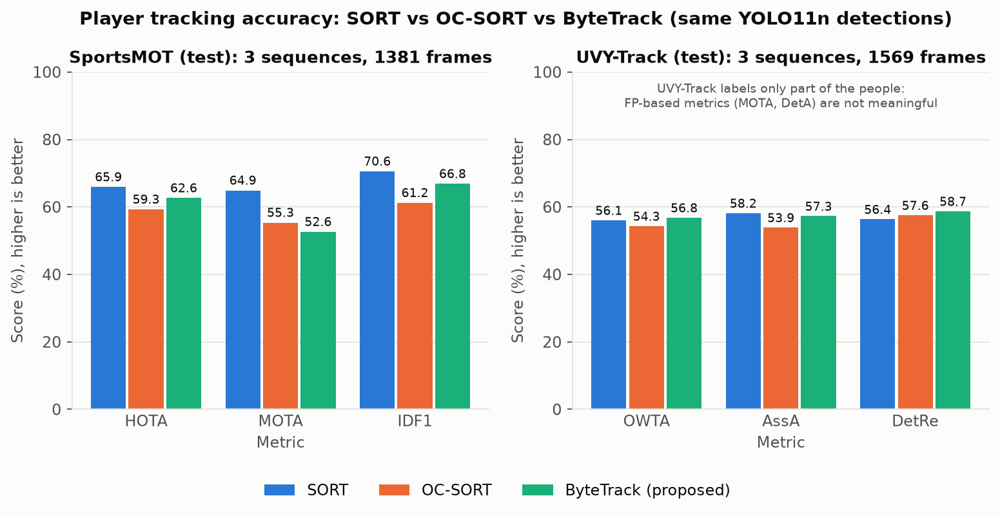

**Figure 2. Detection versus association accuracy.**
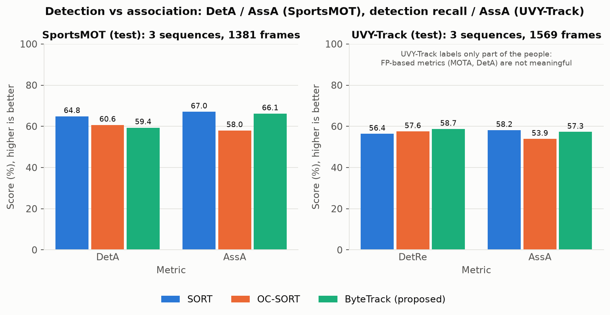

**Figure 3. Precision, recall and F1 for player detection and for the ball (detection only vs Kalman tracker).**
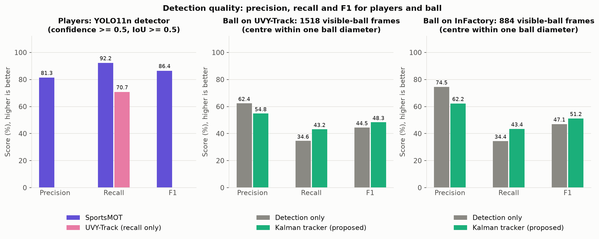

**Figure 4. Runtime: tracking-stage latency, full-pipeline FPS, and time per stage.**
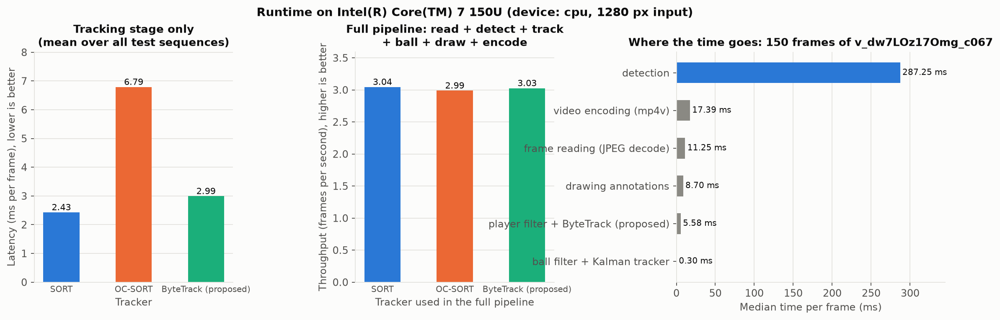

**Figure 5. Identity switches and track fragmentation.**
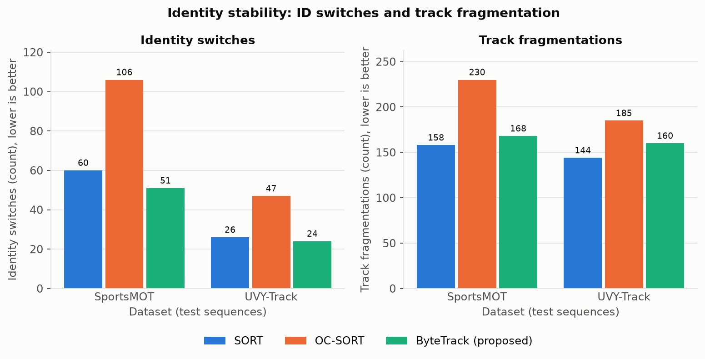

**Figure 6. Player trajectories (ByteTrack) over a SportsMOT frame.**
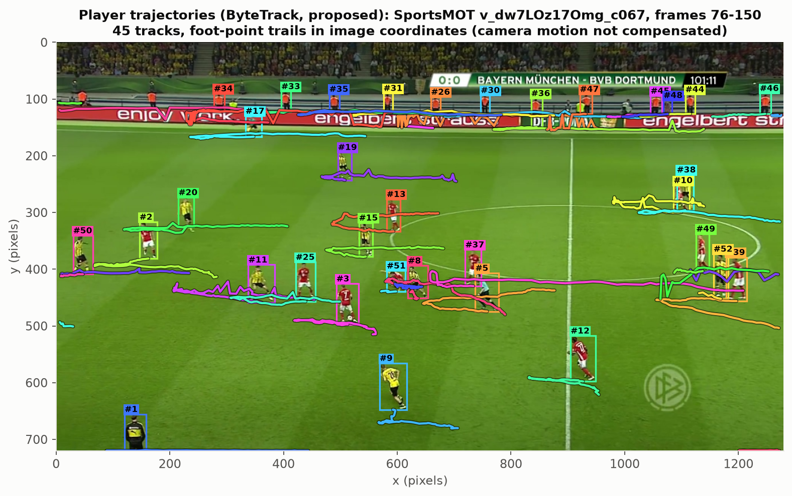

**Figure 7. Player-position heatmap.**
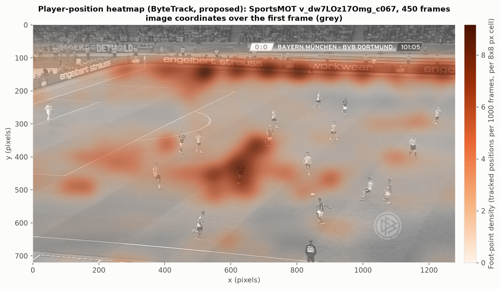

**Figure 8. Ball trajectory with ground truth: detected, predicted and lost frames.**
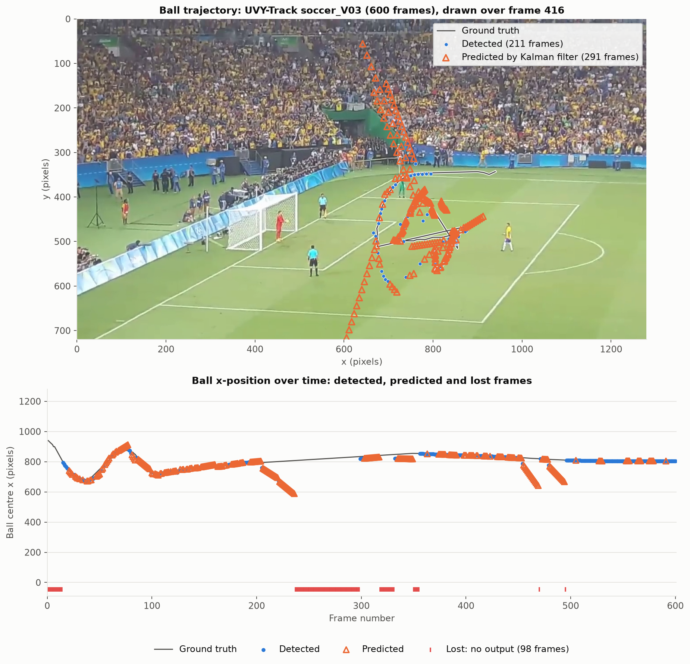

**Figure 9. Ball track status per sequence.**
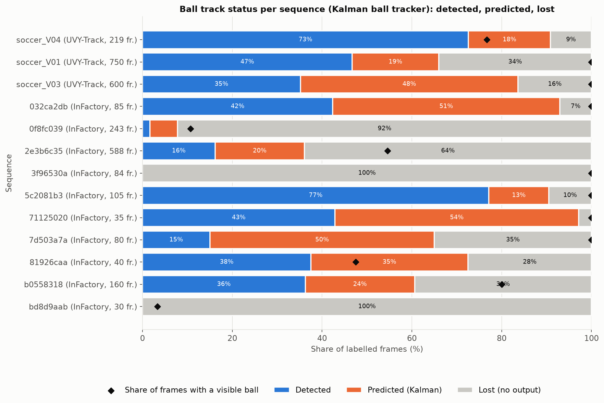

**Figure 10. Precision-recall curve of the ball detector.**
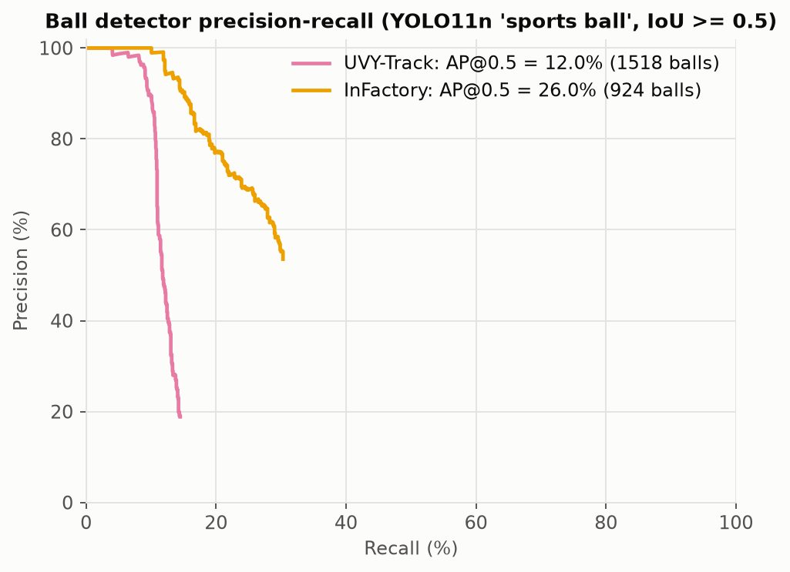

**Figure 11. Per-sequence results.**
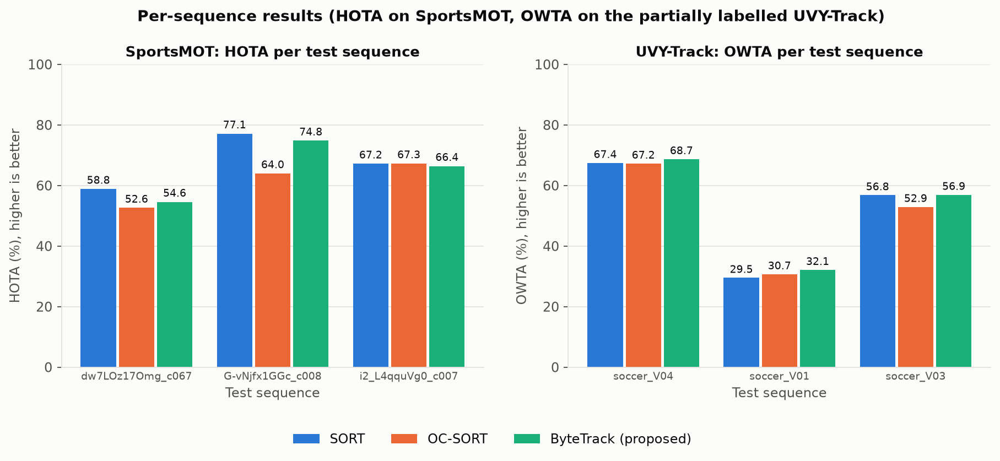

**Figure 12. Hyper-parameter sensitivity on the dev sequence (48 grid points per tracker).**
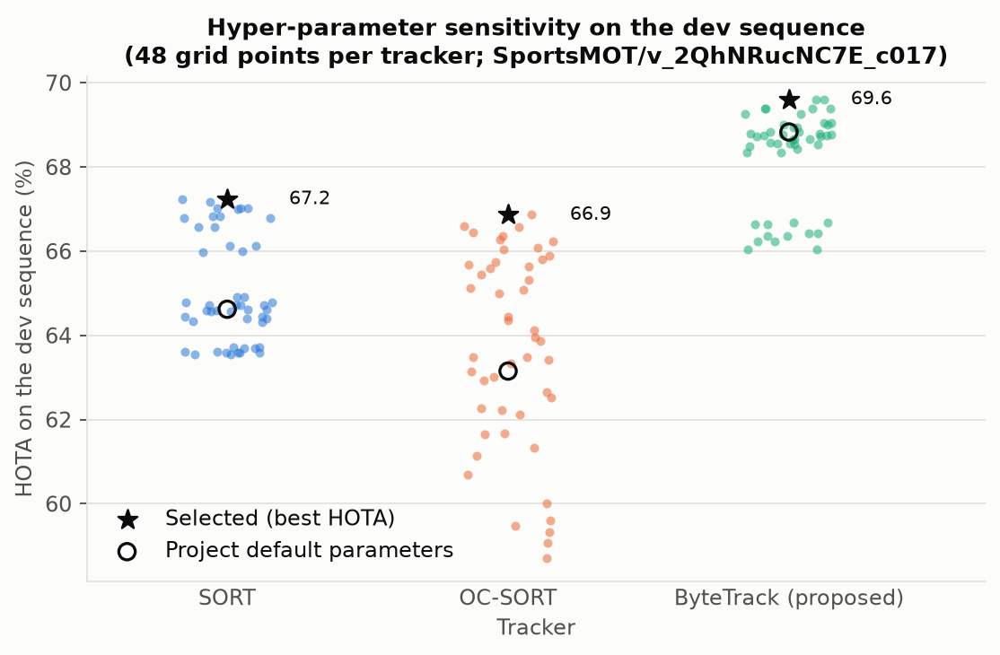

**Figure 13. YOLOv8n vs YOLO11n.**
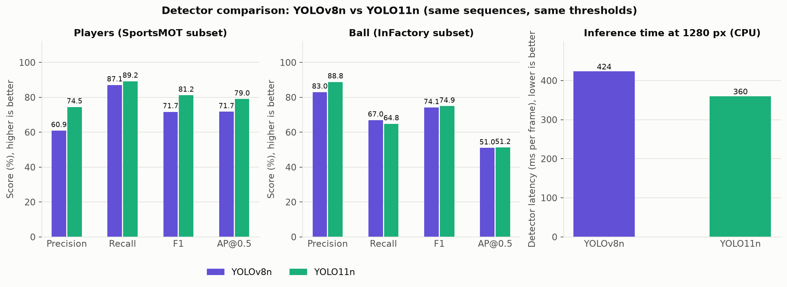

### End-to-end demonstration

The application was run on the UVY-Track clip `soccer_V04` (241 frames, 1280x720,
free kick and goal) with the default configuration:

```bash
python -m soccer_tracker --input data/raw/uvy_track/soccer_V04/vid__fkPwtg7ozU.mp4 -o results/demo/uvy_soccer_V04_annotated.mp4 --output-csv results/demo/uvy_soccer_V04_tracks.csv --output-summary results/demo/uvy_soccer_V04_summary.json --device cpu
```

It processed 241 frames in 81 s (3.0 FPS), produced 31 player track IDs (median
track length 209 frames) and reported the ball in 199 frames: 159 detected, 40
predicted, 42 without output. Outputs are in `results/demo/`.

**Figure 14. Frame of the annotated video: boxes, IDs, trails, ball marker, status line.**
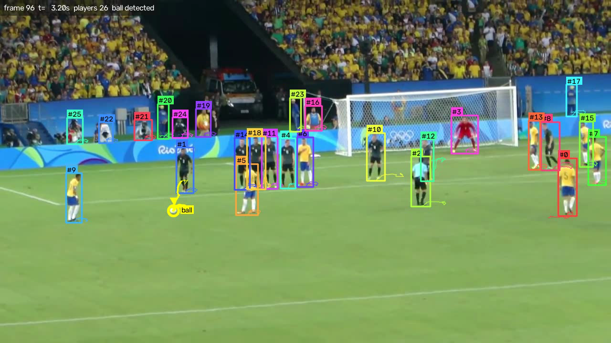

**Figure 15. Player trajectories of the demo run.**
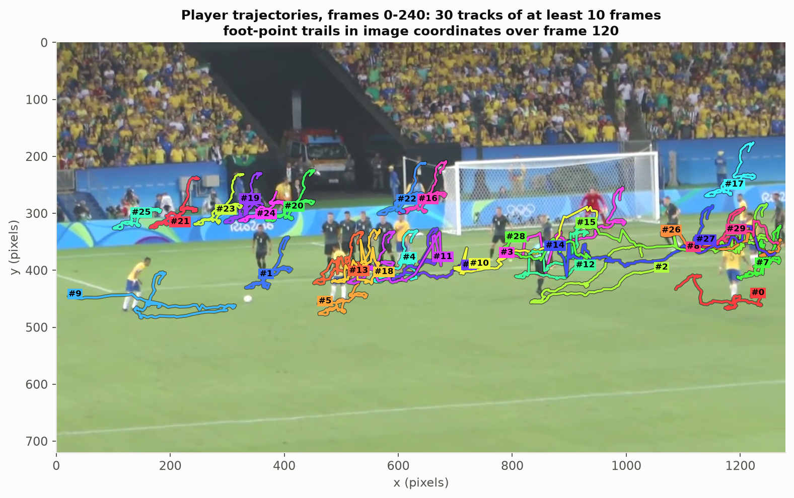

**Figure 16. Ball trajectory of the demo run (system output only).** The straight
lines of orange triangles are the Kalman filter extrapolating after the ball was
struck: a concrete example of why predicted positions are labelled and not trusted
as detections.
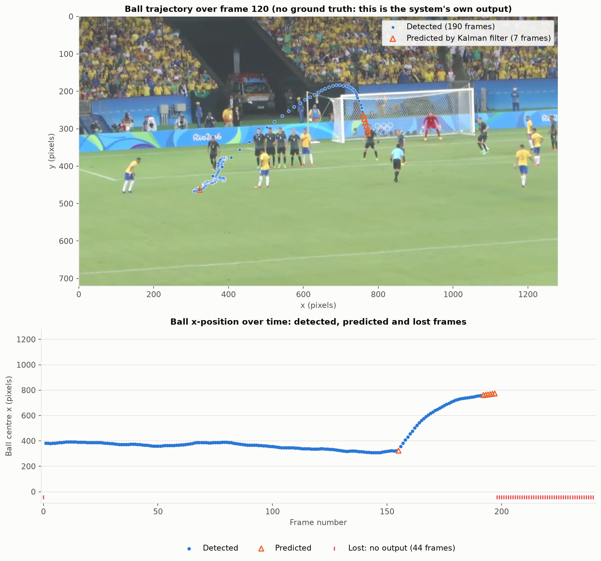

## 17. Runtime and computational performance

Median time per frame on 150 frames of a 1280x720 SportsMOT sequence, measured on
an otherwise idle machine on AC power:

<!-- TABLE:runtime_stages -->
| Stage | Median (ms / frame) | Mean (ms / frame) | 95th percentile (ms) | Share of proposed pipeline |
|---|---|---|---|---|
| frame reading (JPEG decode) | 11.25 | 11.25 | 14.11 | 3.4% |
| detection | 287.25 | 293.01 | 366.83 | 86.9% |
| player filter + SORT | 3.52 | 3.53 | 4.77 | n/a (baseline) |
| player filter + OC-SORT | 9.80 | 10.59 | 16.66 | n/a (baseline) |
| player filter + ByteTrack (proposed) | 5.58 | 5.87 | 8.16 | 1.7% |
| ball filter + Kalman tracker | 0.30 | 0.29 | 0.65 | 0.1% |
| drawing annotations | 8.70 | 8.99 | 13.32 | 2.6% |
| video encoding (mp4v) | 17.39 | 18.59 | 26.62 | 5.3% |
<!-- /TABLE:runtime_stages -->

<!-- TABLE:runtime_pipeline -->
| Full pipeline with | Total time (ms / frame) | Throughput (FPS) |
|---|---|---|
| YOLO11n + SORT | 328.40 | 3.04 |
| YOLO11n + OC-SORT | 334.69 | 2.99 |
| YOLO11n + ByteTrack (proposed) | 330.46 | 3.03 |
<!-- /TABLE:runtime_pipeline -->

Tracking-stage latency averaged over all six test sequences:

<!-- TABLE:tracker_latency -->
| Method | Tracking stage (ms / frame) | Tracking stage alone (FPS) |
|---|---|---|
| YOLO11n + SORT | 2.43 | 411.80 |
| YOLO11n + OC-SORT | 6.79 | 147.30 |
| YOLO11n + ByteTrack (proposed) | 2.99 | 334.40 |
<!-- /TABLE:tracker_latency -->

* The detector takes about 87% of the time. All three trackers cost a few
  milliseconds, so the choice of tracker changes throughput by about 1%.
* SORT is the cheapest tracker, ByteTrack costs about 0.6 ms more per frame for
  its second association stage, and OC-SORT is two to three times slower than
  both. The Kalman ball tracker costs 0.3 ms per frame.
* About 3 FPS means the system is an offline analysis tool on this hardware, not a
  real-time one. Sharing one YOLO pass between players and ball already halves
  the detection cost compared with two passes.
* **Power state matters.** The same benchmark run on battery, with the CPU
  throttled, measured about 1,000 ms per frame for detection and 1.0 FPS overall.
  The power source is recorded in `runtime_benchmark.json`.

## 18. Limitations

* **Generic detector.** COCO `person` also fires on referees, coaches, stewards and
  spectators, and COCO `sports ball` misses most small broadcast balls. This limits
  every number in the report more than the choice of tracker does.
* **The proposed tracker is not uniformly best.** ByteTrack gives the most stable
  identities and the highest recall, but tuned SORT has higher HOTA, MOTA and IDF1
  on SportsMOT in this setting.
* **Small evaluation.** Six tracking test sequences and thirteen ball sequences; one
  dev sequence for tuning, which is too little for the tuned parameters to
  generalise reliably. No confidence intervals are given. Results are not
  comparable with published leaderboards.
* **Partial labels.** UVY-Track annotates only part of the people; FP-based metrics
  are not valid there. SportsMOT has no ball labels; InFactory has no player labels
  and no ball identities, so no single dataset evaluates the whole system.
* **Ball predictions.** A constant-velocity model cannot follow a kicked ball; 57%
  of predicted positions are wrong, and the tracker sometimes locks onto a false
  positive. The ball tracker was not tuned (there was no separate ball dev set).
* **No camera-motion compensation, re-identification, team assignment or pitch
  calibration.** Trajectories and heatmaps are in image pixels, so camera pans
  distort them.
* **Speed.** About 3 FPS on a laptop CPU; 1 FPS on battery.
* **Custom ball evaluator.** Tested, but not an official benchmark tool.

## 19. Future work

1. Soccer-specific detector weights (players, referees, goalkeepers, ball as
   separate classes). This addresses the dominant error source for both players and ball.
2. Tiled high-resolution inference for the ball (already supported by the
   application through `--ball-tiling`, not yet evaluated).
3. A better ball motion model: limit coasting for immature tracks, damp velocity
   while coasting, and smooth offline with a forward-backward pass.
4. Camera-motion compensation and appearance-based re-identification (BoT-SORT [5]).
5. Team assignment from jersey colour, jersey-number recognition.
6. Pitch keypoints and homography for positions in metres, speed and distance.
7. GPU or ONNX/OpenVINO inference for real-time throughput.
8. Evaluation on the complete validation splits, with several dev sequences.

## 20. Conclusion

A complete player-and-ball tracking system was built, tested and evaluated on
three public datasets with a reproducible protocol. With identical detections,
ByteTrack produced the fewest identity switches and the highest recall on both
tracking datasets and the best OWTA on UVY-Track, while tuned SORT obtained the
best HOTA, MOTA and IDF1 on SportsMOT; OC-SORT was the weakest in association
and the slowest. The dedicated Kalman ball tracker improved ball recall, F1 and
above all the continuity of the ball track over detection alone, but its
predicted positions are correct less than half of the time, which justifies
labelling them separately. Across all experiments the generic lightweight
detector, not the tracker, limits both accuracy and speed, so a soccer-specific
detector is the most valuable next step.


## 21. References

[1] A. Bewley, Z. Ge, L. Ott, F. Ramos, B. Upcroft. "Simple Online and Realtime Tracking." IEEE International Conference on Image Processing (ICIP), 2016.

[2] N. Wojke, A. Bewley, D. Paulus. "Simple Online and Realtime Tracking with a Deep Association Metric." IEEE International Conference on Image Processing (ICIP), 2017.

[3] Y. Zhang, P. Sun, Y. Jiang, D. Yu, F. Weng, Z. Yuan, P. Luo, W. Liu, X. Wang. "ByteTrack: Multi-Object Tracking by Associating Every Detection Box." European Conference on Computer Vision (ECCV), 2022.

[4] J. Cao, J. Pang, X. Weng, R. Khirodkar, K. Kitani. "Observation-Centric SORT: Rethinking SORT for Robust Multi-Object Tracking." IEEE/CVF Conference on Computer Vision and Pattern Recognition (CVPR), 2023.

[5] N. Aharon, R. Orfaig, B.-Z. Bobrovsky. "BoT-SORT: Robust Associations Multi-Pedestrian Tracking." arXiv:2206.14651, 2022.

[6] J. Redmon, S. Divvala, R. Girshick, A. Farhadi. "You Only Look Once: Unified, Real-Time Object Detection." IEEE Conference on Computer Vision and Pattern Recognition (CVPR), 2016.

[7] G. Jocher, J. Qiu. "Ultralytics YOLO11." Software, 2024. https://github.com/ultralytics/ultralytics

[8] T.-Y. Lin, M. Maire, S. Belongie, J. Hays, P. Perona, D. Ramanan, P. Dollar, C. L. Zitnick. "Microsoft COCO: Common Objects in Context." European Conference on Computer Vision (ECCV), 2014.

[9] Y. Cui, C. Zeng, X. Zhao, Y. Yang, G. Wu, L. Wang. "SportsMOT: A Large Multi-Object Tracking Dataset in Multiple Sports Scenes." IEEE/CVF International Conference on Computer Vision (ICCV), 2023. https://github.com/MCG-NJU/SportsMOT

[10] A. Cioppa, S. Giancola, A. Deliege, L. Kang, X. Zhou, Z. Cheng, B. Ghanem, M. Van Droogenbroeck. "SoccerNet-Tracking: Multiple Object Tracking Dataset and Benchmark in Soccer Videos." IEEE/CVF Conference on Computer Vision and Pattern Recognition Workshops (CVPRW), 2022.

[11] E. Alencar, R. de Freitas. "UVY: a Dataset of Sport User-Generated Videos from YouTube for Multi-Object Tracking Evaluation." Zenodo, 2026. https://zenodo.org/records/21303900

[12] E. Alencar, L. Pessoa, F. Costa, G. Souza, R. de Freitas. "Comparative Analysis of Deep Learning-Based Multi-Object Tracking Approaches Applied to Sports User-Generated Videos." Proceedings of the 20th International Joint Conference on Computer Vision, Imaging and Computer Graphics Theory and Applications (VISAPP), pp. 691-698, 2025. doi:10.5220/0013185700003912

[13] V. Constantinou, M. Iranmanesh, J. Kanalakis. "Soccer Ball Tracking Dataset." Infactory, 2026. https://huggingface.co/datasets/infactory-ai/ball-tracking

[14] R. E. Kalman. "A New Approach to Linear Filtering and Prediction Problems." Journal of Basic Engineering, 82(1), 1960.

[15] H. W. Kuhn. "The Hungarian Method for the Assignment Problem." Naval Research Logistics Quarterly, 2(1-2), 1955.

[16] J. Komorowski, G. Kurzejamski, G. Sarwas. "DeepBall: Deep Neural-Network Ball Detector." International Conference on Computer Vision Theory and Applications (VISAPP), 2019.

[17] Y.-C. Huang, I.-N. Liao, C.-H. Chen, T.-U. Ik, W.-C. Peng. "TrackNet: A Deep Learning Network for Tracking High-speed and Tiny Objects in Sports Applications." IEEE International Conference on Advanced Video and Signal Based Surveillance (AVSS), 2019.

[18] A. Scott, I. Uchida, M. Onishi, Y. Kameda, K. Fukui, K. Fujii. "SoccerTrack: A Dataset and Tracking Algorithm for Soccer with Fish-eye and Drone Videos." IEEE/CVF Conference on Computer Vision and Pattern Recognition Workshops (CVPRW), 2022.

[19] A. Scott et al. "TeamTrack: A Dataset for Multi-Sport Multi-Object Tracking in Full-pitch Videos." arXiv:2404.13868, 2024.

[20] M. Manafifard, H. Ebadi, H. Abrishami Moghaddam. "A Survey on Player Tracking in Soccer Videos." Computer Vision and Image Understanding, 159, 2017.

[21] F. C. Akyon, S. O. Altinuc, A. Temizel. "Slicing Aided Hyper Inference and Fine-tuning for Small Object Detection." IEEE International Conference on Image Processing (ICIP), 2022.

[22] J. Luiten, A. Osep, P. Dendorfer, P. Torr, A. Geiger, L. Leal-Taixe, B. Leibe. "HOTA: A Higher Order Metric for Evaluating Multi-Object Tracking." International Journal of Computer Vision, 129, 2021.

[23] K. Bernardin, R. Stiefelhagen. "Evaluating Multiple Object Tracking Performance: The CLEAR MOT Metrics." EURASIP Journal on Image and Video Processing, 2008.

[24] E. Ristani, F. Solera, R. Zou, R. Cucchiara, C. Tomasi. "Performance Measures and a Data Set for Multi-Target, Multi-Camera Tracking." European Conference on Computer Vision Workshops (ECCVW), 2016.

[25] Roboflow. "trackers" (software, v2.6.1, Apache-2.0), including `trackers.eval`. https://github.com/roboflow/trackers

[26] J. Luiten, A. Hoffhues. "TrackEval." Software, 2020. https://github.com/JonathonLuiten/TrackEval

[27] Y. Liu, I. E. Zulfikar, J. Luiten, A. Dave, D. Ramanan, B. Leibe, A. Osep, L. Leal-Taixe. "Opening up Open World Tracking." IEEE/CVF Conference on Computer Vision and Pattern Recognition (CVPR), 2022.
